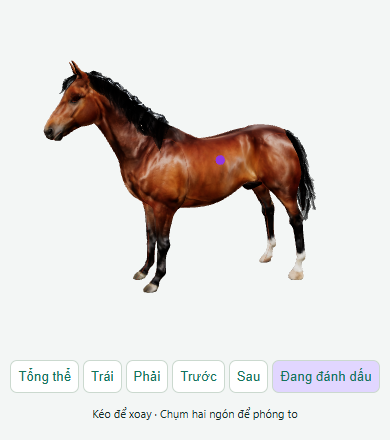

# Mobile: vị trí chấn thương 3D, cập nhật trực tiếp và tìm kiếm

Cập nhật ngày 09/11/2026. Chỉ thay đổi mobile tại C:/WDP/Forntend-mobile/mobile_app. Backend và frontend web chỉ dùng để đối chiếu; không sửa source, cấu hình hay dữ liệu của hai dự án đó.

## Những phần đã làm

| Phần                  | Hành vi mới                                                                                                                                                                                                                                                                                                                                     |
| --------------------- | ----------------------------------------------------------------------------------------------------------------------------------------------------------------------------------------------------------------------------------------------------------------------------------------------------------------------------------------------- |
| Chấn thương 3D        | Form ghi nhận/cập nhật chấn thương và chấn thương trong lần khám có nút mở mô hình. Xoay, phóng to, chọn góc nhìn, bật đánh dấu và chạm bề mặt. App đề xuất vùng/bên, cho người dùng đối chiếu lại trước khi dùng điểm.                                                                                                                         |
| Lưu và xem lại vị trí | Gửi surfaceLocation qua API hiện có khi lưu form. Lưu modelId horse-orelvys, modelVersion 1, layer surface, point/normal trong hệ tọa độ gốc giống web. Chi tiết chấn thương mở lại được điểm đã lưu. Chọn Hủy không thay dữ liệu; đổi ngựa bỏ điểm cũ.                                                                                         |
| Thông báo             | Nhận sự kiện ready/refresh từ GET /notifications/stream bằng Bearer header rồi làm mới danh sách. Không còn hẹn refetch 30 giây. Kết nối được chia sẻ giữa cấp ứng dụng và màn hình thông báo.                                                                                                                                                  |
| Telemetry             | Nhận snapshot từ GET /daily-tasks/:id/telemetry/stream rồi cập nhật cache buổi tập. GET một lần để nạp đầu; không còn polling 2 giây.                                                                                                                                                                                                           |
| Vòng đời SSE          | Tự kết nối lại khi mất mạng với khoảng chờ tăng dần, phát hiện luồng im lặng, đóng khi xuống nền/đăng xuất/hủy màn hình. Khi quay lại app sẽ kết nối lại. Phiên bị thu hồi yêu cầu đăng nhập lại; mất quyền theo dõi dừng luồng và ẩn dữ liệu telemetry.                                                                                        |
| Tìm kiếm ô chọn       | Tìm ngay trong hộp danh sách, chờ 250 ms sau khi gõ, giữ loading/error/retry trong hộp chọn. Các API hỗ trợ search nhận truy vấn từ khóa cùng bộ lọc và phân trang. Các API chưa hỗ trợ search, như /users, được đọc qua các trang trong đúng phạm vi quyền rồi lọc tên/mã/email không phân biệt dấu. Không gửi tham số ngoài hợp đồng backend. |

Mô hình GLB được đóng gói cùng app, không lấy mô hình hoặc mã JavaScript bên ngoài khi mở bộ chọn. Mô hình Horse của OrelvysRodriguez, CC BY 4.0; Three.js MIT. Chi tiết ở [ghi công](../assets/models/ATTRIBUTION.md). Hình học gốc giữ nguyên; chỉ chuẩn hóa hiển thị và thêm điểm đánh dấu.

## Cách kiểm tra trên app

1. Trong thư mục mobile, chạy npx expo start -c rồi mở lại app. Đã bổ sung react-native-webview và expo-asset. Nếu đang dùng development build được tạo trước thay đổi này, tạo lại development build để có module native mới.
2. Đăng nhập bác sĩ. Mở Ghi nhận chấn thương hoặc Ghi nhận lần khám và điều trị, chọn ngựa và thêm phần chấn thương. Nhấn Chọn vị trí trên mô hình, bật Đánh dấu vị trí, chạm ngựa, kiểm tra vùng/bên, chọn Dùng vị trí này rồi lưu toàn bộ hồ sơ. Mở chi tiết chấn thương để xem lại. Chỉ chọn điểm trong mô hình chưa ghi database cho đến khi bạn lưu form.
3. Với thông báo, giữ app đang mở rồi thực hiện một thao tác sinh thông báo ở tài khoản khác. Danh sách nhận cập nhật qua SSE. Cho app xuống nền rồi quay lại để kiểm tra kết nối lại.
4. Với telemetry, mở công việc huấn luyện đủ điều kiện và chạy lượt mô phỏng theo nghiệp vụ hiện có. Chỉ số nhận trực tiếp từ stream; kiểm tra trạng thái kết nối trên thẻ Theo dõi buổi tập.
5. Trong hộp chọn ngựa/vật tư, nhập tên hoặc mã của bản ghi nằm ở trang sau. Với chủ ngựa/nhân viên, thử tên không dấu hoặc email và kiểm tra kết quả ngoài trang đầu. Khi lỗi mạng, hộp chọn có Thử lại.

Cập nhật trực tiếp hoạt động khi app ở foreground. Không bổ sung APNs/FCM hoặc thông báo đẩy khi app đã đóng. Những API chưa có tìm kiếm máy chủ có thể cần thêm thời gian để đọc hết các trang; app hiện trạng thái tải và hủy yêu cầu cũ khi đổi truy vấn.

## Bằng chứng kiểm tra

| Kiểm tra        | Kết quả                                                                                                                                      |
| --------------- | -------------------------------------------------------------------------------------------------------------------------------------------- |
| Jest            | 25 suite, 339 test đạt; tiến trình tự kết thúc                                                                                               |
| TypeScript      | npm run typecheck đạt                                                                                                                        |
| Lint            | npm run lint đạt; sau xử lý static require GLB không còn cảnh báo trong phần src                                                             |
| Android export  | Thành công: 1.788 module, Hermes bundle khoảng 5,5 MB; GLB khoảng 6,9 MB                                                                     |
| Mô hình thực tế | Chrome headless với WebGL phần mềm ở khung 390 x 440: ready, 4 điểm chạm hợp lệ và 1 lần chạm ngoài bề mặt; không có Runtime.exceptionThrown |
| Backend/web     | Fingerprint của git status, diff và các file untracked giữ nguyên so với đầu lượt sửa                                                        |

Kiểm thử gồm giải mã SSE UTF-8 bị chia nhỏ, multiline, giới hạn kích thước, hủy reader, reconnect, 401/403/404, thu hồi phiên, phản hồi muộn của phiên cũ, chia sẻ kết nối, foreground/background/logout; tìm kiếm nhiều trang và hủy truy vấn; debounce/retry trong hộp chọn; chọn/hủy điểm 3D, đổi ngựa, kiểm tra phiên bản và normal vector, chế độ chỉ xem.

Kết quả trên gồm kiểm thử tự động với fixtures và kiểm tra viewer thật. Chưa phải kiểm thử đầu cuối ghi hồ sơ 3D vào database trên điện thoại thật. Android export tạo bundle kiểm tra, chưa tạo APK. Đầu ra tạm: TEMP/equinepro-live-3d-android.

## Bảo trì mô hình

Sau khi sửa scripts/horse-viewer/entry.js, chạy npm run build:horse-viewer để tạo lại assets/models/viewer-runtime.json. Giữ GLB đúng phiên bản; không thay modelId/version nếu chưa đối chiếu backend và web. Mã Three.js được bundle cục bộ, không dùng CDN. Không cần thay đổi backend để dùng những chức năng này.
